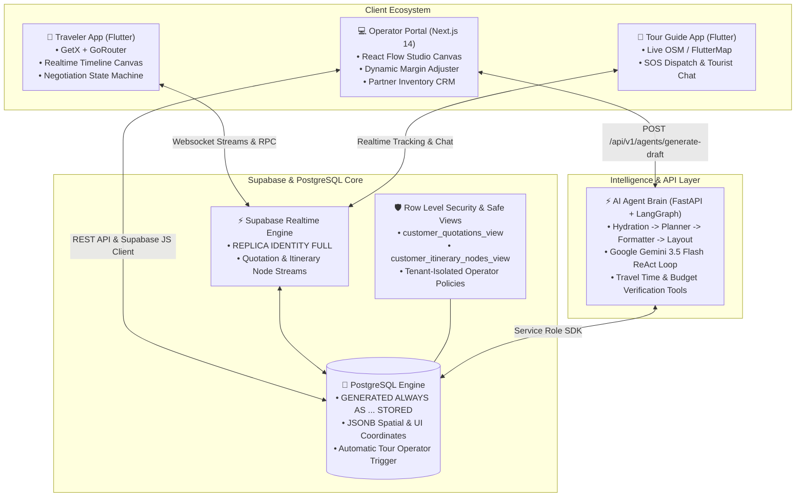

# Journey 🌍
### Next-Generation Dynamic Tour Planning & Real-Time Operations Platform

[](https://flutter.dev/)
[](https://nextjs.org/)
[](https://fastapi.tiangolo.com/)
[](https://langchain-ai.github.io/langgraph/)
[](https://supabase.com/)
[](https://www.postgresql.org/)
[](https://ai.google.dev/)
[](https://www.typescriptlang.org/)
[](https://tailwindcss.com/)

---

## 📖 Executive Overview

**Journey** solves the high-friction, asynchronous operational breakdown in the multi-billion dollar customized travel market. Traditional custom tourism relies on rigid PDF proposals, fragmented email chains, and manual cost estimations that take 48–72 hours per iteration.

Journey reimagines this workflow as a **collaborative, real-time operating system** connecting **Travelers (B2C)**, **Tour Operators (B2B)**, and **Tour Guides (Field Ops)**:

* **For Travelers:** A reactive Flutter mobile experience featuring dynamic itinerary reordering, AI itinerary generation, instant counter-offers, solo traveler clustering, and transparent real-time quote negotiation.
* **For Operators:** An enterprise-grade Next.js 14 web command center powered by an interactive React Flow node canvas, dynamic profit margin calculators, tied-up inventory engines, and automated multi-agent draft generation.
* **For Tour Guides:** A dedicated field operations app delivering live OpenStreetMap GPS navigation, roster check-ins, direct tourist messaging, and instantaneous SOS emergency dispatch.
* **For the Data Layer:** Supabase Realtime with PostgreSQL stored generated columns, customer-safe sanitization views, and ironclad Row Level Security (RLS) guaranteeing zero cost-margin leakage.

---

## 🏛️ System Architecture



### Monorepo Blueprint

```text
journey/
├── app/                              # 📱 Traveler Mobile Application (Flutter)
│   ├── lib/
│   │   ├── controllers/              # GetX reactive controllers (Cart, Travel Mode)
│   │   ├── models/                   # ItineraryNodeModel, QuotationModel, AICommunity
│   │   ├── screens/
│   │   │   ├── quotation_negotiation_screen.dart   # Real-time negotiation & timeline
│   │   │   ├── itinerary_cart_screen.dart          # Multi-city customizable cart
│   │   │   ├── community/                          # Solo traveler hub, chat & live polls
│   │   │   └── confirmed_trip_dashboard_screen.dart# Post-booking timeline & guide tracking
│   │   ├── services/                 # QuotationNegotiationService, SupabaseService
│   │   └── utils/                    # GoRouter configuration, AppTheme tokens
│   └── pubspec.yaml                  # Mobile dependencies (Get, GoRouter, Supabase)
│
├── web_operator_final/               # 💻 Operator Command Center (Next.js 14)
│   ├── src/
│   │   ├── app/
│   │   │   ├── api/quotations/       # B2B quotation upsert & edge mapping endpoints
│   │   │   ├── studio/page.tsx       # Infinite React Flow drag-and-drop itinerary studio
│   │   │   └── page.tsx              # Operator dashboard & incoming trip requests
│   │   ├── components/
│   │   │   ├── canvas/DarkItineraryNode.tsx # Interactive canvas node with live margin controls
│   │   │   ├── TiedUpInventoryView.tsx      # Contracted hotels, fleets, guides CRM
│   │   │   └── NegotiationModal.tsx         # User counter-offer diff review dialog
│   │   └── lib/                      # Supabase JS clients, types, and DB services
│   └── package.json                  # Next 14, React Flow (@xyflow/react), Tailwind
│
├── guide_app/                        # 🧭 Tour Guide Field Operations App (Flutter)
│   ├── lib/
│   │   ├── screens/                  # GuideDashboard, ItineraryMapScreen, SOSDialog
│   │   └── services/                 # Live location stream & tourist room messaging
│   └── pubspec.yaml                  # flutter_map, latlong2, supabase_flutter
│
├── backend/                          # ⚡ Multi-Agent Orchestrator (FastAPI + LangGraph)
│   ├── graph.py                      # 4-stage StateGraph (Hydrate, Planner, Formatter, Layout)
│   ├── main.py                       # FastAPI REST entry point
│   └── requirements.txt              # langgraph, langchain-google-genai, supabase, fastapi
│
└── supabase/                         # 🗄️ Database Architecture & Migrations
    └── migrations/
        ├── 002_operator_inventory.sql        # Tied-up hotels, places, transport, guides
        ├── 003_geo_coordinates.sql           # Spatial indexes & lat/lng columns
        ├── 004_trip_requests_policy.sql      # Client/Operator RLS permissions
        ├── 005_quotations_and_itinerary.sql  # Stored generated pricing, nodes & safe views
        └── supabase_schema_ai_community.sql  # Solo traveler Post-Its, AI clustering & polls
```

---

## ⚡ Key Engineering Features

### 1. Real-Time Quotation State Machine
The core transaction engine synchronizes contract updates between the operator's canvas and the traveler's mobile screen using Supabase Realtime subscriptions.

```text
 ┌─────────┐     Operator Dispatches     ┌──────────┐     Traveler Modifies     ┌────────────────┐
 │  draft  │ ──────────────────────────> │   sent   │ ────────────────────────> │ user_countered │
 └─────────┘                             └──────────┘                           └────────────────┘
                                              │                                         │
                                   Traveler   │                              Operator   │
                                   Accepts    │                              Accepts    │
                                              ▼                                         ▼
                                       ┌──────────────┐                        ┌─────────────────┐
                                       │  finalised   │ <───────────────────── │ operator_agreed │
                                       └──────────────┘                        └─────────────────┘
```

* **Optimistic Local State with Bi-Directional Stream Sync:** [`QuotationNegotiationService`](file:///d:/projects/journey/app/lib/services/quotation_negotiation_service.dart) subscribes directly to PostgreSQL table events via `.stream(primaryKey: ['id'])`. Changes trigger immediate reactive UI updates while network persistence occurs asynchronously.
* **Strict Actionability Guardrails:** Quotations in `draft`, `finalised`, or `declined` states automatically lock interactive handles, disabling destructive reordering or stale counter-proposals.

---

### 2. Drag-and-Drop Vertical Timeline Canvas (`ui_coordinates`)
Rather than treating itineraries as flat lists, Journey structures itineraries as dynamic directed graphs persisted via coordinate metadata.

* **Dual-Platform Coordinate Mapping:**
  * **In Flutter:** Reordering is managed via [`ReorderableListView`](file:///d:/projects/journey/app/lib/screens/quotation_negotiation_screen.dart). Changes are converted into normalized `ui_coordinates` payloads:
    ```json
    { "order": 2, "day": 1, "time": "14:30", "y": 240 }
    ```
  * **In Next.js:** Nodes render on an infinite `@xyflow/react` canvas, mapping continuous Cartesian `(x, y)` coordinates directly to time offsets and day columns.
* **Anchor Guardrails (Fixed Core vs. Draggable Nodes):**
  * Nodes categorized as `HOTEL` or `FLIGHT` are declared immutable anchors (`node.isFixedCore = true`).
  * In the Flutter mobile timeline, attempting to drag an anchor triggers an immediate guardrail intercept, preserving operational integrity (e.g., hotel check-ins and flights cannot be moved across sightseeing activities).

---

### 3. Dynamic Database-Level Pricing Mechanics
To eliminate float drift, rounding inconsistencies, and client-side pricing exploits, calculations are enforced at the PostgreSQL engine level.

* **PostgreSQL Generated Always Stored Columns:**
  In [`005_quotations_and_itinerary.sql`](file:///d:/projects/journey/web_operator_final/supabase/migrations/005_quotations_and_itinerary.sql):
  ```sql
  CREATE TABLE public.itinerary_nodes (
      ...
      base_cost NUMERIC(10, 2) NOT NULL DEFAULT 0.00,
      margin_percentage NUMERIC(5, 2) NOT NULL DEFAULT 0.00,
      final_price NUMERIC(10, 2) GENERATED ALWAYS AS (
          (base_cost + ((base_cost * margin_percentage) / 100::NUMERIC))
      ) STORED,
      ...
  );
  ```
  Neither the Next.js portal nor the Flutter app ever writes to `final_price`. When an operator tweaks a margin slider, Postgres re-evaluates and stores the derived price natively, broadcasting the new figure via Realtime.

* **Dual Customer-Safe View Layer (Zero Margin Leakage):**
  Operators require visibility into raw procurement costs (`base_cost`) and profit margins (`margin_percentage`). Exposing these to travelers would undermine negotiation leverage. Journey enforces strict database views:
  ```sql
  CREATE OR REPLACE VIEW public.customer_itinerary_nodes_view AS
  SELECT 
      n.id AS node_id,
      n.quotation_id,
      n.node_type,
      n.title,
      n.location_subtitle,
      n.day_number,
      n.time_slot,
      n.final_price,        -- ONLY customer price exposed
      n.is_optional,
      n.specs,
      n.ui_coordinates
  FROM public.itinerary_nodes n;
  ```

---

### 4. LangGraph Multi-Agent Itinerary Brain
The `backend/` orchestrates an autonomous planning pipeline powered by LangGraph and Gemini 3.5 Flash:

```text
 [Start] ──> [1. Hydrate Node] ──> [2. Planner Agent] ──> [3. Formatter Node] ──> [4. Layout Node] ──> [End]
                   │                     │                        │                     │
             Pull inventory         ReAct Loop             Strict Pydantic          Compute (x, y)
             from Supabase       (Transit & Budget)         JSON Output             React Flow grid
```

1. **Hydration Node:** Queries Supabase to retrieve operator inventory (hotels, contracted rates, activity durations, fleet vehicles).
2. **Planner Agent Node (ReAct Loop):** Uses specialized tools:
   * `calculate_transit_time(loc_a, loc_b)`: Dynamically checks inter-city transfer durations.
   * `check_budget(current_total, max_budget)`: Enforces hard spending constraints.
3. **Formatter Node:** Enforces a rigid JSON output contract (`ItinerarySchedule`) using Pydantic schema validation.
4. **Layout Node:** Computes Cartesian visual coordinates (`minutes_from_midnight * 1.5`), emitting pre-spaced nodes and animated smoothstep connector edges directly onto the operator's canvas.

---

### 5. AI Solo Community & Dynamic Activity Opt-Out
Solo travelers often abandon plans due to single-supplement costs. Journey introduces a dynamic clustering engine:
* **Trip Post-Its:** Solo travelers publish trip intents with destination, dates, and budget.
* **AI Communities:** Clustered groups share a **Fixed Core** (hotel accommodation and private transport vehicle fleet split among members) while maintaining a **Flexible Activity Roster**.
* **Personalized Budget Computation:** Members can opt out of individual activities via [`opted_out_activity_ids`](file:///d:/projects/journey/supabase_schema_ai_community.sql), recalculating individual estimated budgets on the fly without breaking the shared group quote.

---

## 🛡️ Database & Security Architecture

### Relational Hierarchy

| Table | Primary Key | Foreign Keys & Relationships | Responsibilities |
| :--- | :--- | :--- | :--- |
| `tour_operators` | `id (UUID)` | `auth.users(id)` | Company profile, credentials, automated signup trigger. |
| `operator_inventory` | `id (UUID)` | `operator_id -> tour_operators(id)` | Catalog of contracted hotels, activities, places, transport fleet. |
| `trip_requests` | `id (UUID)` | `user_id -> auth.users(id)` | Traveler inbound trip parameters, passenger count, budget. |
| `quotations` | `id (UUID)` | `trip_request_id`, `operator_id` | Master contract, total base cost, status machine, valid_until. |
| `itinerary_nodes` | `id (UUID)` | `quotation_id -> quotations(id)` | Individual itinerary events, computed final price, UI coordinates. |
| `itinerary_edges` | `id (UUID)` | `source_node_id`, `target_node_id` | Graph connections, transit times, inter-item distances. |

### Row Level Security (RLS) Implementation
All core tables enforce strict PostgreSQL RLS policies:
* **Operator Multi-Tenant Isolation:** Tour operators are restricted to managing only items where `operator_id = auth.uid()`.
* **Automated Profile Provisioning:** A PostgreSQL `SECURITY DEFINER` trigger automatically registers a `tour_operators` profile row on user creation:
  ```sql
  CREATE TRIGGER on_auth_user_created
      AFTER INSERT ON auth.users
      FOR EACH ROW EXECUTE FUNCTION public.handle_new_tour_operator();
  ```
* **Realtime Publication Configuration:** Tables are registered in the Supabase replication publication with `REPLICA IDENTITY FULL` to deliver complete row diffs across active WebSockets:
  ```sql
  ALTER PUBLICATION supabase_realtime ADD TABLE public.quotations;
  ALTER PUBLICATION supabase_realtime ADD TABLE public.itinerary_nodes;
  ALTER TABLE public.quotations REPLICA IDENTITY FULL;
  ALTER TABLE public.itinerary_nodes REPLICA IDENTITY FULL;
  ```

---

## 🛠️ Technology Stack Breakdown

| Layer | Technologies & Libraries |
| :--- | :--- |
| **Traveler App (Mobile)** | **Flutter 3.x / Dart 3.13+**, `get` (Reactive State), `go_router` (Deep Linking), `supabase_flutter` (Realtime streams), `google_fonts`, `flutter_dotenv`, `google_generative_ai` |
| **Operator Portal (Web)** | **Next.js 14 (App Router)**, **React 18**, **TypeScript**, `@xyflow/react` (React Flow v12 Canvas), `tailwindcss`, `lucide-react`, `@supabase/supabase-js` |
| **Tour Guide App (Mobile)**| **Flutter 3.x**, `flutter_map` (OpenStreetMap), `latlong2`, `supabase_flutter`, `flutter_dotenv` |
| **AI Orchestrator (Backend)**| **Python 3.11+**, **FastAPI**, **LangGraph**, **LangChain**, `langchain-google-genai` (Gemini 3.5 Flash), `pydantic`, `uvicorn` |
| **Database & Cloud** | **PostgreSQL 15+**, **Supabase** (Auth, Storage, Realtime Engine, Row Level Security, Triggers, Views) |

---

## 🚀 Getting Started

### Prerequisites
* [Flutter SDK](https://docs.flutter.dev/get-started/install) (`^3.13.2` or later)
* [Node.js](https://nodejs.org/) (`v18.17+` or `v20+`) and `npm`
* [Python 3.10+](https://www.python.org/)
* A [Supabase](https://supabase.com/) project with database access
* A [Google AI Studio](https://aistudio.google.com/) Gemini API Key

---

### Step 1: Supabase Database Setup
1. Log in to your Supabase Dashboard and navigate to the **SQL Editor**.
2. Run the SQL migration scripts in this order:
   * [`web_operator_final/supabase/migrations/002_operator_inventory.sql`](file:///d:/projects/journey/web_operator_final/supabase/migrations/002_operator_inventory.sql)
   * [`web_operator_final/supabase/migrations/003_geo_coordinates.sql`](file:///d:/projects/journey/web_operator_final/supabase/migrations/003_geo_coordinates.sql)
   * [`web_operator_final/supabase/migrations/004_trip_requests_policy.sql`](file:///d:/projects/journey/web_operator_final/supabase/migrations/004_trip_requests_policy.sql)
   * [`web_operator_final/supabase/migrations/005_quotations_and_itinerary.sql`](file:///d:/projects/journey/web_operator_final/supabase/migrations/005_quotations_and_itinerary.sql)
   * [`supabase_schema_ai_community.sql`](file:///d:/projects/journey/supabase_schema_ai_community.sql)
3. Ensure Realtime is enabled for the tables:
   ```sql
   ALTER PUBLICATION supabase_realtime ADD TABLE public.quotations;
   ALTER PUBLICATION supabase_realtime ADD TABLE public.itinerary_nodes;
   ALTER TABLE public.quotations REPLICA IDENTITY FULL;
   ALTER TABLE public.itinerary_nodes REPLICA IDENTITY FULL;
   ```

---

### Step 2: Traveler Mobile App (`app/`)

1. Navigate to the app directory:
   ```bash
   cd app
   ```
2. Create and configure your `.env` file:
   ```bash
   cp .env.example .env
   ```
   Populate `.env` with your credentials:
   ```env
   SUPABASE_URL=https://your-project-id.supabase.co
   SUPABASE_ANON_KEY=your-supabase-anon-key
   GEMINI_API_KEY=your-gemini-api-key
   GEMINI_MODEL=gemini-3.5-flash
   ```
3. Fetch dependencies and launch:
   ```bash
   flutter pub get
   flutter run
   ```

---

### Step 3: Web Operator Command Center (`web_operator_final/`)

1. Navigate to the operator portal directory:
   ```bash
   cd web_operator_final
   ```
2. Create your `.env.local` file:
   ```env
   NEXT_PUBLIC_SUPABASE_URL=https://your-project-id.supabase.co
   NEXT_PUBLIC_SUPABASE_ANON_KEY=your-supabase-anon-key
   SUPABASE_SERVICE_ROLE_KEY=your-supabase-service-role-key
   ```
3. Install dependencies and start the Next.js development server:
   ```bash
   npm install
   npm run dev
   ```
4. Open [http://localhost:3000](http://localhost:3000) to access the dashboard and studio canvas.

---

### Step 4: AI Agent Server (`backend/`)

1. Navigate to the backend directory:
   ```bash
   cd backend
   ```
2. Create a virtual environment and install dependencies:
   ```bash
   python -m venv venv
   # On Windows:
   venv\Scripts\activate
   # On macOS/Linux:
   source venv/bin/activate

   pip install -r requirements.txt
   ```
3. Create your `.env` file:
   ```env
   SUPABASE_URL=https://your-project-id.supabase.co
   SUPABASE_KEY=your-supabase-service-role-key
   GOOGLE_API_KEY=your-gemini-api-key
   ```
4. Start the FastAPI development server:
   ```bash
   uvicorn main:app --host 0.0.0.0 --port 8000 --reload
   ```
   Interactive OpenAPI docs are available at [http://localhost:8000/docs](http://localhost:8000/docs).

---

### Step 5: Tour Guide Operations App (`guide_app/`)

1. Navigate to the guide app directory:
   ```bash
   cd guide_app
   ```
2. Create `.env`:
   ```env
   SUPABASE_URL=https://your-project-id.supabase.co
   SUPABASE_ANON_KEY=your-supabase-anon-key
   ```
3. Run the application:
   ```bash
   flutter pub get
   flutter run
   ```

---

## 🔐 Quality & Architectural Highlights

* **Zero Price Drift:** By offloading quote sum and per-person cost calculations to PostgreSQL `STORED GENERATED` columns, Journey prevents reconciliation mismatch errors across disparate mobile and web clients.
* **Information Security via Separation of Concerns:** Database views ensure travelers never receive proprietary vendor wholesale rates or operator margin percentages.
* **Resilient Offline-First UX:** Flutter screens utilize optimistic state mutation for drag-and-drop operations, synchronizing to remote storage in the background while gracefully reconciling server conflicts.
* **Modular Multi-Agent Graph:** The LangGraph architecture isolates retrieval, spatial routing, and format validation into discrete, independently testable nodes.

---

<p align="center">
  <b>Built with modern engineering principles for the future of connected travel.</b>
</p>
